# Laberinto y salida de menor distancia

**Laboratorio de Estructuras de Datos · Proyecto 5 (2026)** · Java 17+ · Swing · sin librerías externas

🎬 **Video del proyecto:** [ver en YouTube](https://youtu.be/m0gGccr6f3A)

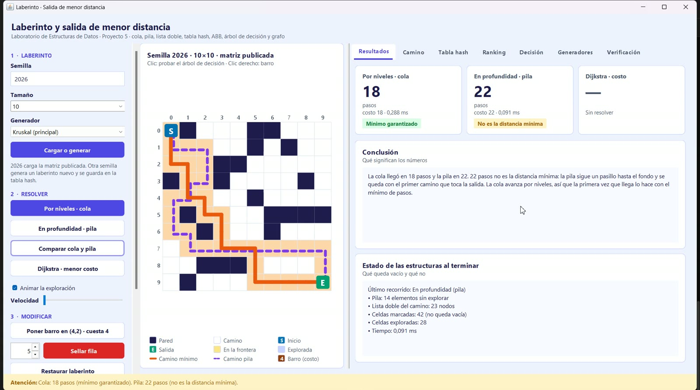

## ¿Qué hace?

El programa encuentra la salida de un laberinto y muestra, paso a paso, cómo lo hacen distintas
estructuras de datos. Con la semilla 2026 carga la matriz publicada y la resuelve
de dos formas: **por niveles con una cola (18 pasos)** y **en profundidad con una pila (22 pasos)**.
Las dos llegan a la salida, pero solo una garantiza la distancia mínima.

> **Por qué 22 no es la distancia mínima:** la pila explora en profundidad y se queda con el primer
> camino que toca la salida; solo la cola, que avanza por niveles, garantiza que la primera vez que
> llega lo hace con el menor número de pasos cuando cada paso cuesta uno.

Además guarda cada laberinto en una **tabla hash** por su semilla, lleva un **ranking** en un árbol
binario de búsqueda, decide qué hacer con cada celda vecina con un **árbol de decisión**, calcula el
camino de **menor costo con Dijkstra** cuando hay barro y **genera laberintos sin ciclos** con Kruskal y Prim.

---

## Cómo ejecutarlo

Requisito: **JDK 17 o superior** (`java -version` y `javac -version`).

| Qué quiero | Windows (PowerShell) | Linux / macOS / Git Bash |
|---|---|---|
| Abrir la interfaz gráfica | `.\ejecutar.ps1` | `./ejecutar.sh` |
| Ver la corrida de verificación | `.\ejecutar.ps1 consola` | `./ejecutar.sh consola` |
| Solo compilar | `.\compilar.ps1` | — |

Si PowerShell bloquea los scripts:
`powershell -ExecutionPolicy Bypass -File .\ejecutar.ps1`

**Desde un IDE (IntelliJ, NetBeans, Eclipse, VS Code):** marque la carpeta `src` como carpeta de
fuentes y ejecute la clase `laberinto.Main`. Con el argumento `--consola` imprime la verificación.

---

## Organización del código

Cada paquete tiene una sola responsabilidad. Las flechas indican quién usa a quién: la interfaz y la
consola solo conocen la fachada `JuegoLaberinto`, y todo se apoya en las estructuras propias.

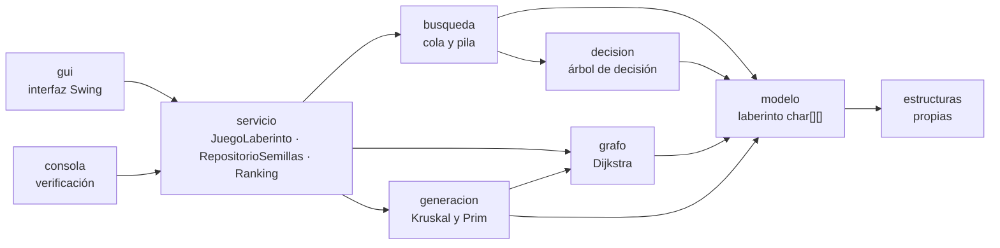

```
src/laberinto/
├── Main.java
├── estructuras/
│   ├── ArbolBinarioBusqueda.java
│   ├── ArregloDinamico.java
│   ├── Cola.java
│   ├── ColaPrioridad.java
│   ├── EstructuraVaciaException.java
│   ├── Frontera.java
│   ├── ListaDoble.java
│   ├── NodoDoble.java
│   ├── NodoSimple.java
│   ├── Pila.java
│   ├── TablaHash.java
│   └── UnionFind.java
├── modelo/
│   ├── Coordenada.java
│   ├── DibujoTexto.java
│   ├── Direccion.java
│   ├── Laberinto.java
│   ├── LaberintosPredefinidos.java
│   ├── PasoExploracion.java
│   ├── RegistroPartida.java
│   ├── ResultadoBusqueda.java
│   └── TipoCelda.java
├── decision/
│   ├── Accion.java
│   ├── ArbolDecision.java
│   ├── ContextoVecino.java
│   └── NodoDecision.java
├── busqueda/
│   ├── ReconstructorCamino.java
│   ├── Recorrido.java
│   ├── RecorridoEnProfundidad.java
│   └── RecorridoPorNiveles.java
├── grafo/
│   ├── Arista.java
│   ├── Dijkstra.java
│   ├── Grafo.java
│   └── NodoGrafo.java
├── generacion/
│   ├── EjemploCuatroCeldas.java
│   ├── GeneradorKruskal.java
│   ├── GeneradorLaberinto.java
│   ├── GeneradorPrim.java
│   ├── ParedEntreCeldas.java
│   ├── ResultadoGeneracion.java
│   ├── ReticulaDeCeldas.java
│   └── VerificadorSinCiclos.java
├── servicio/
│   ├── JuegoLaberinto.java
│   ├── Ranking.java
│   └── RepositorioSemillas.java
├── consola/
│   └── CorridaVerificacion.java
└── gui/
    ├── AccionesUsuario.java
    ├── Animador.java
    ├── BarraEstado.java
    ├── BotonTema.java
    ├── Componentes.java
    ├── Leyenda.java
    ├── PanelCamino.java
    ├── PanelConsola.java
    ├── PanelControles.java
    ├── PanelDecision.java
    ├── PanelGeneradores.java
    ├── PanelLaberinto.java
    ├── PanelRanking.java
    ├── PanelResultados.java
    ├── PanelTablaHash.java
    ├── PestanasTema.java
    ├── Tarjeta.java
    ├── Tema.java
    └── VentanaPrincipal.java
```

### Dónde está cada estructura

| Estructura | Clase | Para qué se usa |
|---|---|---|
| Cola sobre lista simple | `estructuras/Cola.java` | Frontera del recorrido por niveles: 18 pasos, mínimo garantizado |
| Pila sobre lista simple | `estructuras/Pila.java` | Frontera del recorrido en profundidad: 22 pasos, no es el mínimo |
| Lista doblemente enlazada | `estructuras/ListaDoble.java` | Camino de (0,0) a (9,9) y de regreso por el enlace `anterior` |
| Tabla hash | `estructuras/TablaHash.java` | Semilla → laberinto; 5 cubetas; 2026 y 2031 chocan en la cubeta 1 |
| Árbol binario de búsqueda | `estructuras/ArbolBinarioBusqueda.java` | Ranking por pasos (inorden) |
| Árbol binario de decisión | `decision/ArbolDecision.java` | Qué hacer con cada vecina |
| Grafo | `grafo/Grafo.java` | Dijkstra con barro; verificación de ciclos |
| Cola de prioridad (montículo) | `estructuras/ColaPrioridad.java` | Dijkstra |
| Union-Find | `estructuras/UnionFind.java` | Kruskal |

**No se usan** `Queue`, `ArrayDeque`, `Stack`, `LinkedList`, `ArrayList`, `HashMap`, `TreeMap`
ni `PriorityQueue`. La matriz del laberinto es un `char[][]`.

---|---|
| **S** · Responsabilidad única | Cada clase hace una cosa: `Laberinto` guarda la matriz, `DibujoTexto` la convierte en texto, `PanelLaberinto` dibuja y `Animador` lleva el tiempo de la animación. |
| **O** · Abierto/cerrado | Un recorrido nuevo solo extiende `Recorrido` y elige su `Frontera`; un generador nuevo implementa `GeneradorLaberinto`. No se toca el código existente. |
| **L** · Sustitución de Liskov | `Cola` y `Pila` se usan donde se pide una `Frontera`; `GeneradorKruskal` y `GeneradorPrim` donde se pide un `GeneradorLaberinto`. |
| **I** · Segregación de interfaces | Interfaces pequeñas: `Frontera` (6 métodos), `GeneradorLaberinto` (1), `OyenteCeldas` (2), `AccionesUsuario` (solo los botones). |
| **D** · Inversión de dependencias | `Recorrido` depende de la interfaz `Frontera`, no de `Cola` o `Pila`. La interfaz gráfica solo conoce la fachada `JuegoLaberinto`. |
| **KISS** | Un solo algoritmo de búsqueda para cola y pila; métodos cortos; sin librerías externas. |
| **DRY** | Validaciones y limpiezas repetidas están en un solo método (`exigir`, `leerNumero`, `limpiarResultados`, `unirFilas`). |

Además:
- **El árbol de decisión es un árbol de verdad**: nodos pregunta con hijo "sí" y "no", y hojas
  con una acción. Los dos recorridos le preguntan qué hacer con cada vecina.
- **El original no se toca**: la tabla guarda el laberinto; el barro y la fila sellada se aplican
  sobre una copia. "Restaurar" vuelve a la copia limpia.
- **Comentarios cortos**: los nombres explican el código. Solo hay una línea de máximo cinco
  palabras sobre cada clase y en los puntos clave (orden de vecinos, desempate, enlace anterior).

---

## Guía de uso, paso a paso

La ventana tiene tres zonas: **barra lateral** (izquierda), **tablero** (centro) y **pestañas**
(derecha). La barra lateral está numerada en el orden en que conviene usarla, y la barra de estado
de abajo explica qué acaba de pasar.

### Paso 1 · Laberinto
1. Deje la semilla en **2026** y el tamaño en **10**. Pulse **Cargar o generar**.
   → Aparece la matriz publicada y queda guardada en la **cubeta 1** de la tabla hash.
2. Escriba **2031** y pulse de nuevo. → Se genera con Kruskal (verá la animación) y queda en la
   **misma cubeta 1**, encadenada después de 2026.
3. Vuelva a pedir **2026**. → La barra de estado dice *"reutilizada, no se volvió a construir"*.
4. Escriba **12** en Tamaño. → Se rechaza con un mensaje y no se crea ninguna matriz.
5. Pruebe **15** y **21** con *Kruskal* o *Prim* en el selector de generador.

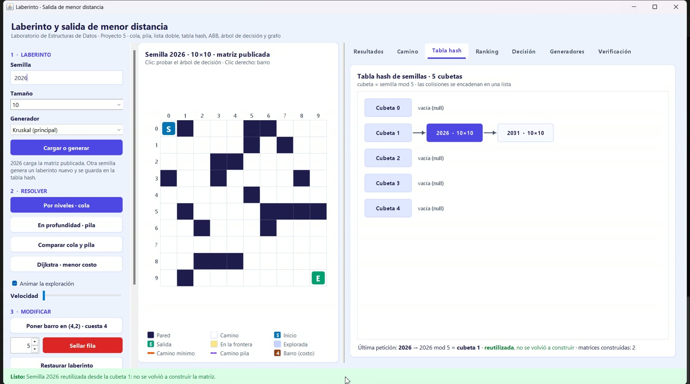

### Paso 2 · Resolver
1. **Por niveles · cola** → anima la exploración (amarillo = en la cola, azul = ya explorada) y
   traza el camino naranja: **18 pasos**, insignia *Mínimo garantizado*.
2. **En profundidad · pila** → **22 pasos**, insignia *No es la distancia mínima*.
3. **Comparar cola y pila** → los dos caminos a la vez (naranja continuo y violeta discontinuo)
   y la conclusión escrita en *Resultados*.
4. La pestaña **Camino** muestra la lista doble de ida y de regreso, y el dibujo con asteriscos.
5. **Animar la exploración** y **Velocidad** controlan la animación.

| Exploración por niveles | Lista doble del camino |
|---|---|
| 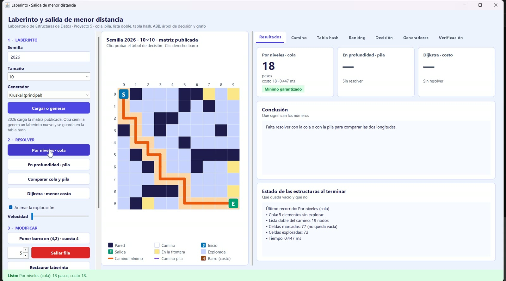 | 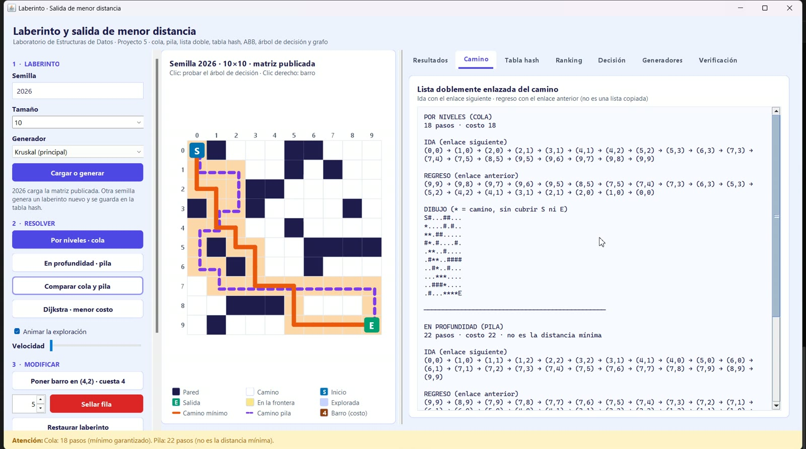 |

### Paso 3 · Modificar
1. **Poner barro en (4,2) · cuesta 4** → la celda se vuelve café con un "4".
   - Cola: sigue en **18 pasos**, pero con costo 21 (no mira el peso).
   - **Dijkstra · menor costo**: rodea el barro, **costo 20**.
2. **Clic derecho** sobre cualquier celda libre: pone o quita barro.
3. **Sellar fila** con 5 → la fila 5 queda en pared. Al resolver, la tarjeta dice **Sin salida**
   y *Estado de las estructuras* muestra la **cola vacía** y la **lista del camino vacía**.
4. **Restaurar laberinto** quita el barro y las filas selladas.

| Barro y Dijkstra | Fila 5 sellada |
|---|---|
| 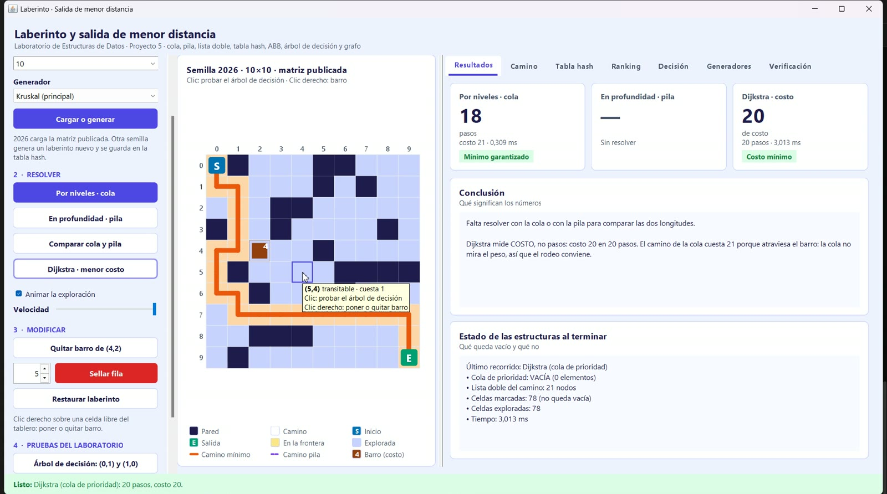 | 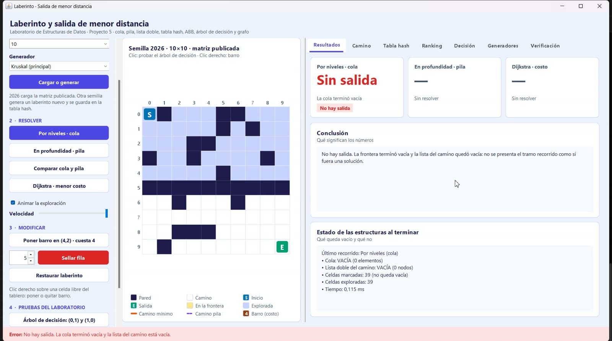 |

### Paso 4 · Pruebas del laboratorio
1. **Árbol de decisión: (0,1) y (1,0)** → (0,1) *no se visita*; (1,0) *se marca y se encola*.
   También puede hacer **clic izquierdo** sobre cualquier celda del tablero.
2. **Ranking: 22 · 18 · 30 · 14 · 25** → dibuja el ABB, inorden **14, 18, 22, 25, 30**,
   **peso 4, altura 2, no es completo**, y busca 18: camino **22 → 18, nivel 1**.
3. **Corrida de verificación completa** → la pestaña *Verificación* muestra cada comprobación
   con [OK].

| Árbol de decisión | Ranking (ABB) |
|---|---|
| 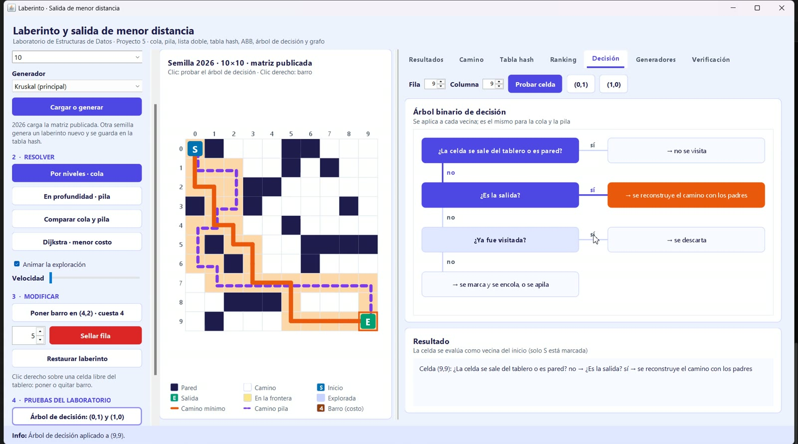 | 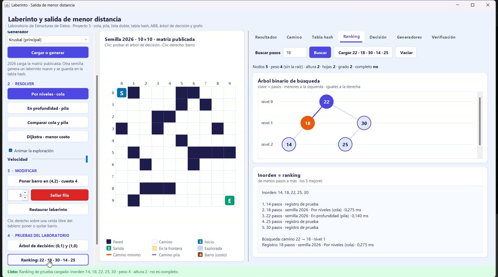 |

---

## Corrida de verificación

`.\ejecutar.ps1 consola` (o el botón de la interfaz) compara cada resultado del programa con
el valor esperado. Resultado: **35 comprobaciones correctas, 0 fallas**.

| Punto | Resultado esperado | Obtenido |
|---|---|---|
| Semilla 2026 | 10 líneas, S en (0,0), E en (9,9) | ✔ |
| Por niveles | 18 pasos, camino publicado | ✔ |
| Ida / regreso | (0,0) → … → (9,9) y (9,9) → … → (0,0) por el enlace anterior | ✔ |
| En profundidad | 22 pasos, no es la distancia mínima | ✔ |
| Árbol de decisión | (0,1) no se visita · (1,0) se encola | ✔ |
| Tabla hash | 2026 y 2031 en la cubeta 1; la 2.ª petición de 2026 reutiliza | ✔ |
| Ranking | inorden 14, 18, 22, 25, 30 · peso 4 · altura 2 · no completo | ✔ |
| Barro (4,2) = 4 | Dijkstra 20 por el rodeo publicado · la cola sigue en 18 | ✔ |
| Fila 5 en pared | no hay salida; cola, pila y camino vacíos | ✔ |
| Tamaños | 15 y 21 sin ciclos con Kruskal y Prim · 12 rechazado | ✔ |
| Cuatro celdas | Se aceptan A—B, A—C, B—D · se rechaza C—D | ✔ |

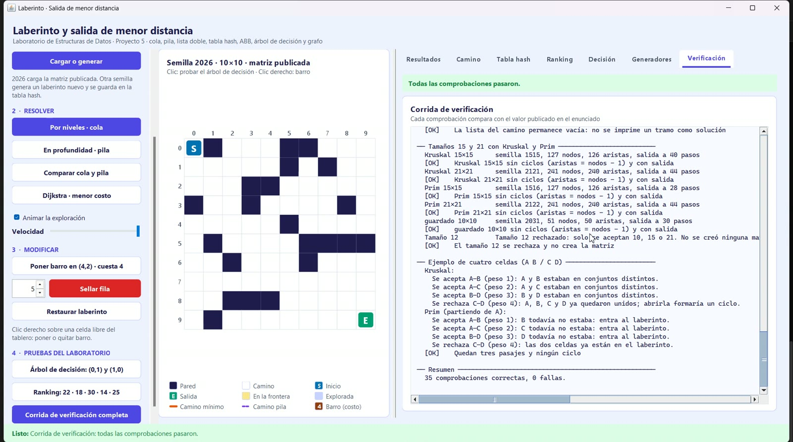

### Detalles que importan
- **Orden de vecinos**: se agregan **sur, norte, este, oeste** (`Direccion.ordenDeInsercion()`).
  Como la pila retira el último, la pila explora primero el oeste. La cola usa el mismo orden.
- **Desempate de Dijkstra**: con igual costo sale primero lo último que entró. No cambia el costo
  (20), pero hace que el camino coincida con el publicado.
- **Laberintos de tamaño par (10)**: las celdas del generador están en posiciones pares hasta (8,8);
  se abre un pasillo (8,9) → (9,9) hacia la salida que toca una sola celda, así no se forma ciclo.

---

## Kruskal y Prim con cuatro celdas

```
A B     A—B = 1 · A—C = 2 · B—D = 3 · C—D = 4
C D
```

**Kruskal** (ordena por peso y usa Union-Find):
1. A—B (1): A y B en conjuntos distintos → **se abre**.
2. A—C (2): A y C en conjuntos distintos → **se abre**.
3. B—D (3): B y D en conjuntos distintos → **se abre**.
4. C—D (4): A, B, C y D ya están unidos → **se rechaza** (formaría un ciclo).

**Prim** (parte de A y crece por la frontera):
1. Frontera {A—B, A—C} → abre A—B, entra B.
2. Frontera {A—C, B—D} → abre A—C, entra C.
3. Frontera {B—D, C—D} → abre B—D, entra D.
4. C—D: las dos celdas ya están → se rechaza.

Los dos dejan **tres pasajes y ningún ciclo**. En el generador real, Kruskal usa pesos aleatorios
y Prim elige la frontera al azar; el ejemplo usa los pesos para poder seguirlo a mano.

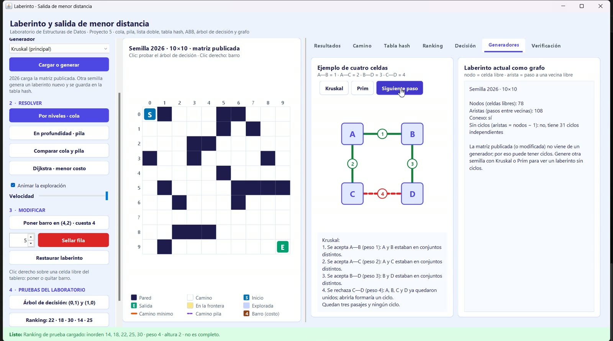

---

## Uso de IA

Usamos un asistente de IA (Claude, de Anthropic) en dos tareas:

- **Revisar los resultados:** comparar lo que entrega el programa con los valores esperados
  (18, 22, 20, la cubeta 1, el inorden del ranking, la fila sellada) y escribir la corrida
  de verificación que lo comprueba automáticamente (35 comprobaciones).
- **Diseñar la interfaz:** elegir la paleta de colores y ordenar la barra lateral en los
  pasos 1 a 4.

---

## Integrantes y aportes

| Integrante | GitHub | Sección | Commits |
|---|---|---|---|
| Jhessid Santiago De Jesús Ruiz | [jhessiddejesus-jpg](https://github.com/jhessiddejesus-jpg) | 1 · Estructuras propias y modelo del laberinto | Estructuras de datos · Modelo del laberinto |
| Juanita Valentina Martínez | [jvmartinez-dev](https://github.com/jvmartinez-dev) | 2 · Árbol de decisión, recorridos, grafo, generadores, servicio y verificación | Árbol de decisión y recorridos · Grafo y generadores · Servicio y verificación |
| Ronny Farid Guevara Galvis | [rguevara-ship-it](https://github.com/rguevara-ship-it) | 3 · Interfaz gráfica, punto de entrada y scripts | Tema y componentes · Tablero y pestañas · Ventana principal y scripts |

Las secciones 2 y 3 se integraron a `main` con los pull requests #1 y #2.
